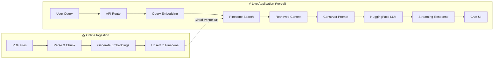

# 🧠 MindfulAI — Mental Health RAG Chatbot

A production-ready **Retrieval-Augmented Generation (RAG)** chatbot for mental health support, built with Next.js, Pinecone, and Hugging Face. Deployed on Vercel's serverless platform.

## Architecture



## Tech Stack

| Layer | Technology |
|---|---|
| **Frontend** | Next.js 15 (App Router) + Tailwind CSS v4 |
| **Backend** | Vercel Serverless Functions (Node.js) |
| **LLM** | Hugging Face Inference API (Llama-3-8B-Instruct) |
| **Embeddings** | `sentence-transformers/all-MiniLM-L6-v2` |
| **Vector DB** | Pinecone (Serverless, 384-dim, cosine) |
| **Ingestion** | Python script with pypdf + langchain |

## Prerequisites

- **Node.js** 18.17+ and npm
- **Python** 3.10+ (for ingestion only)
- **Hugging Face** account with [API token](https://huggingface.co/settings/tokens)
- **Pinecone** account with [API key](https://app.pinecone.io)

## Quick Start

### 1. Clone & Install

```bash
# Install Node.js dependencies
npm install

# Install Python dependencies (for ingestion)
pip install -r scripts/requirements.txt
```

### 2. Configure Environment

```bash
# Copy the environment template
cp .env.example .env.local

# Edit .env.local with your API keys
```

Required variables:
- `HF_TOKEN` — Hugging Face API token
- `PINECONE_API_KEY` — Pinecone API key
- `PINECONE_INDEX_NAME` — Name of your Pinecone index
- `HF_MODEL_ID` — LLM model ID (default: `meta-llama/Meta-Llama-3-8B-Instruct`)
- `HF_EMBEDDING_MODEL` — Embedding model (default: `sentence-transformers/all-MiniLM-L6-v2`)

### 3. Ingest PDF Data

Place your PDF files in the `./data` directory, then run:

```bash
python scripts/ingest.py
```

This will:
1. Parse all PDFs in `./data`
2. Split text into 1000-char chunks with 200-char overlap
3. Generate 384-dim embeddings via Hugging Face API
4. Create a Pinecone index (if needed) and upsert all vectors

### 4. Run Development Server

```bash
npm run dev
```

Open [http://localhost:3000](http://localhost:3000) to see the chatbot.

### 5. Deploy to Vercel

```bash
# Install Vercel CLI
npm i -g vercel

# Deploy
vercel --prod
```

Set the same environment variables in your [Vercel project settings](https://vercel.com/docs/environment-variables).

## Project Structure

```
├── app/
│   ├── api/chat/route.ts     # Streaming chat API endpoint
│   ├── globals.css            # Tailwind CSS + custom styles
│   ├── layout.tsx             # Root layout with fonts
│   └── page.tsx               # Main chat page
├── components/chat/
│   ├── ChatContainer.tsx      # Chat message area
│   ├── ChatInput.tsx          # Message input
│   ├── EmptyState.tsx         # Welcome screen
│   ├── ErrorBanner.tsx        # Error display
│   └── MessageBubble.tsx      # Message rendering
├── lib/
│   ├── huggingface.ts         # HF Inference API client
│   ├── pinecone.ts            # Pinecone vector DB client
│   ├── prompts.ts             # LLM prompt templates
│   └── utils.ts               # Utility functions
├── types/
│   └── chat.ts                # TypeScript interfaces
├── scripts/
│   ├── ingest.py              # PDF ingestion pipeline
│   └── requirements.txt       # Python dependencies
├── data/                      # Source PDF files
├── .env.example               # Environment template
├── next.config.ts
├── package.json
├── postcss.config.mjs
└── tsconfig.json
```

## How It Works

### Ingestion (Offline)
The `scripts/ingest.py` script processes your mental health PDF documents:
- **Parsing**: Extracts text from each PDF page using `pypdf`
- **Chunking**: Splits text into overlapping chunks for better context retrieval
- **Embedding**: Converts chunks to 384-dimensional vectors via Hugging Face API
- **Storage**: Stores vectors + original text in Pinecone for fast similarity search

### Chat (Live)
When a user sends a message:
1. **Embed**: The query is converted to a vector using the same embedding model
2. **Search**: Pinecone finds the 5 most relevant text chunks
3. **Prompt**: A context-enriched prompt is constructed for the LLM
4. **Stream**: The LLM response streams back token-by-token for a smooth UX

### Prompt Engineering
The system prompt instructs the LLM to:
- Be compassionate, empathetic, and supportive
- Ground answers in the retrieved context
- Recommend professional help for serious concerns
- Never diagnose or prescribe treatments

## Environment Variables Reference

| Variable | Required | Default | Description |
|---|---|---|---|
| `HF_TOKEN` | ✅ | — | Hugging Face API token |
| `HF_MODEL_ID` | ❌ | `meta-llama/Meta-Llama-3-8B-Instruct` | LLM for chat |
| `HF_EMBEDDING_MODEL` | ❌ | `sentence-transformers/all-MiniLM-L6-v2` | Embedding model |
| `PINECONE_API_KEY` | ✅ | — | Pinecone API key |
| `PINECONE_INDEX_NAME` | ❌ | `mental-health-chatbot` | Pinecone index name |
| `NEXT_PUBLIC_APP_NAME` | ❌ | `MindfulAI` | App display name |

## License

MIT
